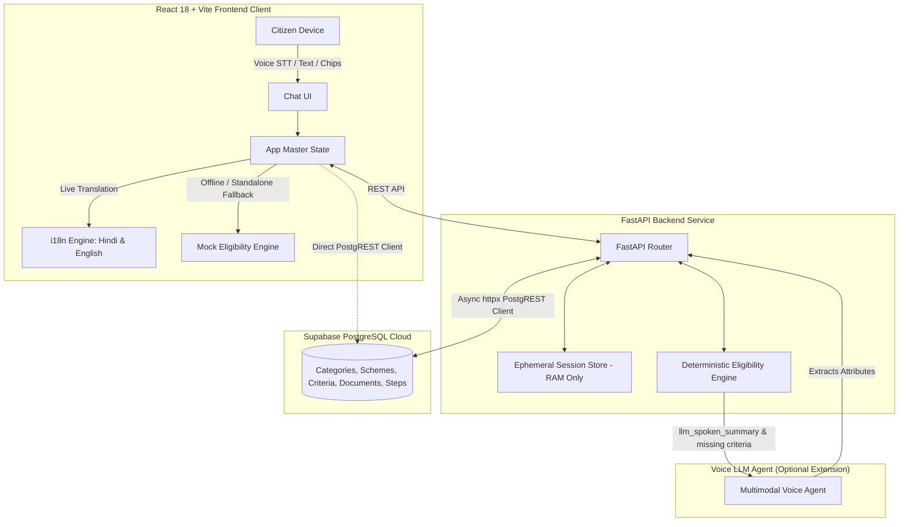

# SchemeSathi (योजना साथी) 🇮🇳

> **Privacy-First, Bilingual AI Conversational Guidance Platform for Indian Government Welfare Scheme Discovery & Eligibility.**

[](https://opensource.org/licenses/MIT)
[](https://react.dev/)
[](https://vitejs.dev/)
[](https://tailwindcss.com/)
[](https://fastapi.tiangolo.com/)
[](https://www.python.org/)
[](https://supabase.com/)
[](#-zero-pii--privacy-first-architecture)

---

## 📌 Table of Contents

- [Overview & The Problem](#-overview--the-problem)
- [Key Features](#-key-features)
- [Zero-PII & Privacy Architecture](#-zero-pii--privacy-first-architecture)
- [System Architecture](#-system-architecture)
- [Monorepo Directory Structure](#-monorepo-directory-structure)
- [Supported Categories & Schemes](#-supported-categories--schemes)
- [Quickstart & Installation](#-quickstart--installation)
  - [Prerequisites](#prerequisites)
  - [1. Database Setup (Supabase)](#1-database-setup-supabase)
  - [2. Backend Setup (FastAPI)](#2-backend-setup-fastapi)
  - [3. Frontend Setup (React + Vite)](#3-frontend-setup-react--vite)
- [API Reference](#-api-reference)
- [Voice LLM Agent Integration](#-voice-llm-agent-integration)
- [Running Automated Tests](#-running-automated-tests)
- [Roadmap](#-roadmap)
- [Contributors & Team](#-contributors--team)
- [License](#-license)

---

## 💡 Overview & The Problem

The Government of India and state administrations run over **800+ welfare schemes** spanning direct income transfers, subsidized crop insurance, educational scholarships, maternity assistance, senior pensions, and small business credit. 

However, millions of eligible citizens—especially **rural farmers, women, daily-wage laborers, and marginalized youth**—fail to claim benefits because:
1. **Complex Bureaucratic Jargon**: Official rules and gazettes are difficult for citizens to comprehend.
2. **Predatory Middlemen & Scams**: Citizens often pay illegitimate fees to touts or unverified agents.
3. **Privacy Anxiety**: Citizens are rightfully reluctant to share Aadhaar, bank details, or phone numbers on third-party websites.
4. **Literacy & Language Barriers**: Most government portals are text-heavy and English-first.

**SchemeSathi solves this.** It acts as an empathetic digital bridge: a zero-login, privacy-guaranteed, multilingual conversational companion that interviews citizens in plain everyday language and matches them to official schemes in **just 2 to 3 targeted questions**.

---

## ✨ Key Features

- **🔒 Zero Authentication / Zero PII**: No phone numbers, no Aadhaar, no accounts, and no cookies. User profiles exist solely in volatile RAM and vanish the moment the browser tab is closed.
- **🗣️ Multi-Modal Input & Output**:
  - **Speech-to-Text (STT)**: Tap the microphone to speak questions in Hindi or English using the Web Speech API.
  - **Text-to-Speech (TTS)**: Listen aloud to application steps and criteria explanations.
  - **One-Tap Quick Reply Chips**: Mobile-friendly chips tailored for low-literacy citizens.
  - **Natural Typing**: Freely describe your situation in natural language.
- **🌐 Full Bilingual Parity (हिन्दी / English)**: Live, instant toggle between English and Hindi that synchronizes active chat history, profile attributes, criteria breakdowns, and scheme cards.
- **⚙️ Deterministic Eligibility Engine**: Evaluates official criteria (landholding size, income ceilings, age brackets, gender restrictions, rural/urban residence) against real government rules. Every recommendation provides transparent **passed**, **failed**, and **missing** criteria.
- **🤖 Voice LLM Agent Ready**: Includes a specialized FastAPI backend with session management, missing-rule feedback, and conversational speech summaries (`llm_spoken_summary`) designed for multimodal Voice LLMs (Gemini Live, Whisper, Sarvam AI, ElevenLabs).
- **🛡️ Anti-Scam & Middleman Warning**: Alerts citizens that government applications are **100% free** and provides direct links to verified `.gov.in` nodal ministry portals and official Common Service Centres (CSCs).
- **📋 Interactive Document Checklist**: On every scheme page, citizens can check off required physical documents (e.g., Aadhaar, Khatoni/Jamabandi, Bank Passbook, e-Shram card) with a live progress indicator before visiting an office.

---

## 🔒 Zero-PII & Privacy-First Architecture

SchemeSathi adheres to strict data minimization:

```
┌─────────────────────────────────────────────────────────────┐
│                   Citizen Device (Browser)                  │
│  - All state in React memory (useState)                     │
│  - 0 LocalStorage | 0 SessionStorage | 0 Tracking Cookies    │
└──────────────────────────────┬──────────────────────────────┘
                               │ Ephemeral Session (UUID)
                               ▼
┌─────────────────────────────────────────────────────────────┐
│                 SchemeSathi FastAPI Backend                 │
│  - SessionStore: Ephemeral Python Dictionary in RAM         │
│  - 30-Minute Inactivity Auto-Sweep (Background Task)        │
│  - Explicit DELETE /api/session/{id} on tab close           │
│  - Zero Disk Logging | Zero Database User Tables            │
└─────────────────────────────────────────────────────────────┘
```

1. **No User Database Table**: Our Supabase database only stores public government scheme catalogues and criteria rules. There is **no `users` table**.
2. **Ephemeral Memory Sessions**: The backend holds session data in a thread-safe Python memory dictionary with a strict 30-minute Time-To-Live (TTL).
3. **Instant Purge**: When a citizen resets their session, an explicit `DELETE` call instantly purges their profile from RAM.

---

## 🏗️ System Architecture



---

## 📂 Monorepo Directory Structure

```
SchemeSathi/
├── .gitignore                            # Root Git ignore rules
├── package.json                          # Root workspace orchestrator
├── README.md                             # Primary project documentation
├── CONTRIBUTING.md                       # Contribution guidelines & coding standards
├── context.md                            # Comprehensive architectural specification
├── supabase_schema_and_seed.sql          # PostgreSQL DDL & 30-scheme seed data
├── VOICE_LLM_AGENT_INTEGRATION_GUIDE.md  # Voice agent integration manual
│
├── schemesathi-frontend/                 # React 18 + Vite frontend
│   ├── index.html                        # HTML entry point with Noto Sans & Bricolage fonts
│   ├── package.json                      # Frontend dependencies & scripts
│   ├── vite.config.js                    # Vite configuration
│   ├── tailwind.config.js                # Custom palette (Saffron, Ink, Mist, Paper)
│   ├── .env.example                      # Frontend environment template
│   └── src/
│       ├── App.jsx                       # Master state holder, session orchestrator & router
│       ├── main.jsx                      # React DOM mounting
│       ├── i18n.js                       # Bilingual dictionaries & regex pattern translation
│       ├── i18n.extra.js                 # Extended strings for navigation & static pages
│       ├── components/                   # Navbar, Footer, ResultCard, StatusBadge, WhoTiles, Chips
│       ├── hooks/                        # useRoute (zero-dep hash router), useVoice (Web Speech STT/TTS)
│       ├── pages/                        # Home, Chat, Results, SchemeDetail, Schemes, HowItWorks, About
│       └── services/
│           ├── api.js                    # Unified REST client & standalone mock engine
│           └── supabaseClient.js         # Direct Supabase PostgREST client & criteria evaluator
│
└── schemesathi-backend/                  # FastAPI Python backend
    ├── requirements.txt                  # Python dependencies (FastAPI, uvicorn, pydantic, httpx)
    ├── run.py                            # Application entry point
    ├── .env.example                      # Backend environment template
    ├── tests/                            # Pytest automated test suite (14 passing tests)
    │   ├── test_session_store.py         # Memory lifecycle & TTL tests
    │   ├── test_eligibility.py           # Deterministic rules evaluator tests
    │   └── test_live_api.py              # API endpoint integration tests
    └── app/
        ├── config.py                     # Pydantic v2 application settings
        ├── main.py                       # FastAPI application & lifespan manager
        ├── models/                       # Pydantic models (profile, scheme, session)
        ├── routers/                      # session.py, schemes.py, eligibility.py
        └── services/
            ├── session_store.py          # Ephemeral RAM session store with sweep worker
            ├── supabase_service.py       # Async PostgREST client with in-memory scheme cache
            └── eligibility_engine.py     # Deterministic rules engine & spoken summary generator
```

---

## 📑 Supported Categories & Schemes

SchemeSathi currently seeds **30 verified government schemes** (5 per category) across 6 national citizen categories:

| Category | Schemes Included |
| :--- | :--- |
| **🌾 Farmers (किसान)** | PM Kisan Samman Nidhi, PM Fasal Bima Yojana (PMFBY), Kisan Credit Card (KCC), PM Krishi Sinchayee Yojana, PM Kisan Maandhan Yojana |
| **🎓 Students (छात्र)** | Pre-Matric Minority Scholarship, Post-Matric SC Scholarship, National Means-cum-Merit, Central Sector College Scholarship, Pragati Scholarship for Girls |
| **👩 Women (महिला)** | PM Matru Vandana Yojana (PMMVY), Sukanya Samriddhi Yojana, Lakhpati Didi Scheme, Mahila Coir Yojana, Working Women Hostel Scheme |
| **👴 Senior Citizens (वरिष्ठ)** | Indira Gandhi National Old Age Pension (IGNOAPS), PM Vaya Vandana Yojana, Rashtriya Vayoshri Yojana, Varishtha Pension Bima, Senior Citizens Welfare Fund |
| **👷 Workers (श्रमिक)** | e-Shram Social Security, PM Shram Yogi Maandhan (PM-SYM), PM Suraksha Bima Yojana (PMSBY), PM Jeevan Jyoti Bima Yojana (PMJJBY), Atal Pension Yojana (APY) |
| **🏪 Small Business (व्यापारी)** | PM SVANidhi (Street Vendors), PM MUDRA Yojana, PMEGP Scheme, Stand-Up India, Credit Guarantee Scheme (CGTMSE) |

---

## 🚀 Quickstart & Installation

### Prerequisites

- **Node.js**: `v18.0.0` or higher ([Download Node.js](https://nodejs.org/))
- **Python**: `v3.10` or higher ([Download Python](https://www.python.org/))
- **Git**: Installed and configured
- **Supabase Account**: Free tier at [supabase.com](https://supabase.com/) (or use the included standalone offline mode)

---

### 1. Database Setup (Supabase)

1. Create a new project in your [Supabase Dashboard](https://supabase.com/dashboard).
2. Open the **SQL Editor** in the Supabase Dashboard.
3. Paste and run the entire contents of [`supabase_schema_and_seed.sql`](./supabase_schema_and_seed.sql).
4. Copy your **Project URL** and **Publishable Anon Key** from `Project Settings -> API`.

---

### 2. Backend Setup (FastAPI)

1. Navigate to the backend directory:
   ```bash
   cd schemesathi-backend
   ```
2. Create and activate a Python virtual environment:
   ```bash
   # Windows (PowerShell)
   python -m venv venv
   .\venv\Scripts\Activate.ps1

   # Linux / macOS
   python3 -m venv venv
   source venv/bin/activate
   ```
3. Install dependencies:
   ```bash
   pip install -r requirements.txt
   ```
4. Configure environment variables:
   ```bash
   cp .env.example .env
   ```
   Edit `.env` with your Supabase details:
   ```env
   SUPABASE_URL=https://your-project-id.supabase.co
   SUPABASE_KEY=sb_publishable_your_key_here
   SESSION_TTL_MINUTES=30
   HOST=127.0.0.1
   PORT=8000
   DEBUG=True
   ```
5. Start the backend server:
   ```bash
   python run.py
   ```
   API will be live at `http://127.0.0.1:8000`.  
   Interactive Swagger docs available at `http://127.0.0.1:8000/docs`.

---

### 3. Frontend Setup (React + Vite)

1. In a new terminal, navigate to the frontend directory:
   ```bash
   cd schemesathi-frontend
   ```
2. Install dependencies:
   ```bash
   npm install
   ```
3. Configure environment variables:
   ```bash
   cp .env.example .env
   ```
   Edit `.env` to connect to Supabase and the FastAPI backend:
   ```env
   VITE_SUPABASE_URL=https://your-project-id.supabase.co
   VITE_SUPABASE_ANON_KEY=sb_publishable_your_key_here
   VITE_API_URL=http://127.0.0.1:8000
   ```
   *(Note: You can leave `VITE_API_URL` empty to run the frontend in standalone client-side mock mode).*
4. Start the development server:
   ```bash
   npm run dev
   ```
5. Open `http://localhost:5173` in your browser.

---

## 📡 API Reference

| Method | Endpoint | Description |
| :--- | :--- | :--- |
| `POST` | `/api/session` | Create an ephemeral session in RAM with language preference (`en` / `hi`). |
| `GET` | `/api/session/{id}` | Inspect current session profile state (returns 404 if expired/purged). |
| `DELETE`| `/api/session/{id}` | Explicitly wipe session from RAM immediately on tab close or user reset. |
| `POST` | `/api/session/{id}/profile` | Update profile with new attributes and return re-evaluated scheme results. |
| `POST` | `/api/eligibility/evaluate` | **Stateless evaluation endpoint**: Send a `UserProfile` payload, get instant evaluated schemes + `llm_spoken_summary`. |
| `GET` | `/api/schemes` | Fetch all active schemes categorized with bilingual support (`?language=hi`). |
| `GET` | `/api/schemes/{code}` | Fetch complete scheme details including mandatory documents and steps. |

---

## 🎙️ Voice LLM Agent Integration

SchemeSathi is designed to pair seamlessly with Voice LLMs (e.g. Gemini Multimodal Live, Sarvam AI, OpenAI Realtime, Groq Whisper):

1. **Listen to Citizen**: The voice agent transcribes spoken Hindi/English audio.
2. **Extract Attributes**: The agent parses attributes into standard keys (`occupation`, `landholding_hectares`, `annual_income`, `state`, `area`, `gender`).
3. **Call Engine**: Agent sends a `POST` request to `/api/eligibility/evaluate`.
4. **Targeted Follow-Up**: The engine returns which schemes need more information and specifies the exact missing criteria (`target.missing`). The voice agent speaks only that targeted question instead of random inquiries.
5. **Speak Result**: The engine generates a natural spoken summary (`llm_spoken_summary`) ready to be voiced by TTS.

For complete integration code, curl examples, and JSON schemas, see [`VOICE_LLM_AGENT_INTEGRATION_GUIDE.md`](./VOICE_LLM_AGENT_INTEGRATION_GUIDE.md).

---

## 🧪 Running Automated Tests

### Backend Unit & Integration Tests (14 Tests)

```bash
cd schemesathi-backend
pytest tests/ -v
```

All 14 tests cover:
- In-memory session creation, updates, and 30-minute TTL sweeping.
- Explicit session deletion (zero PII guarantee).
- Eligibility rules evaluation (landholding limits, income ceilings, gender restrictions, rural/urban zoning).
- Live FastAPI REST router endpoints.

### Frontend Production Build Test

```bash
cd schemesathi-frontend
npm run build
```

---

## 🗺️ Roadmap

- [x] Initial React 18 + Vite prototype with zero-dependency hash router.
- [x] Dual-language English/Hindi live translation engine with pattern translators.
- [x] Ephemeral FastAPI backend with in-memory session manager.
- [x] 30 verified Indian government schemes seeded into Supabase.
- [x] Multimodal voice STT input & audio narration TTS output.
- [x] Dynamic follow-up question injection for missing eligibility criteria.
- [ ] Add more regional Indian languages (Tamil, Telugu, Bengali, Marathi, Punjabi).
- [ ] Offline-first Progressive Web App (PWA) mode for remote rural areas.
- [ ] WhatsApp Bot integration using the FastAPI stateless evaluation endpoint.

---

## 👥 Contributors & Team

Crafted with dedication by the SchemeSathi core civic tech team:

- **Lakshay Gupta** — `garglakshay292@gmail.com` ([LinkedIn](https://www.linkedin.com/in/lakshay-garg-32380228a/))
- **Sameer Mishra** — `mrsameer12082006@gmail.com` ([LinkedIn](https://www.linkedin.com/in/sameer-mishra2006))
- **Manik Chauhan** — `manik8877010@gmail.com` ([LinkedIn](https://www.linkedin.com/in/manik-chauhan-5221573b7/))
- **Yukti Yadav** — `yuktiyadav92122@gmail.com` ([LinkedIn](https://www.linkedin.com/in/yukti-yadav-038b32380/))
- **Prince Punia** — `ppunia325@gmail.com` ([LinkedIn](https://www.linkedin.com/in/prince-punia-5694a3382/))

---

## 📄 License

This project is licensed under the **MIT License** — see the [LICENSE](LICENSE) file for details.

> *Disclaimer: SchemeSathi is an independent civic-tech open-source initiative and is not affiliated with or endorsed by any government entity. All application decisions rest solely with the respective government ministries and nodal authorities.*
